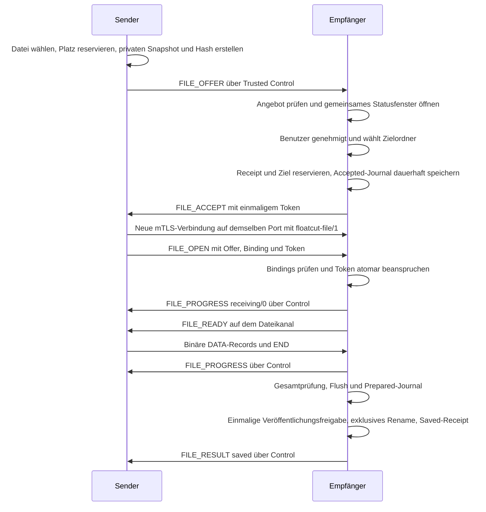

# Implementierungsplan für Floatcut Sync V3 mit Dateiübertragung auf macOS

Stand: 2026-10-11. Ziel ist die vollständige Umstellung der macOS-App auf
Floatcut Sync V3 einschließlich des optionalen Dateiprofils `file.transfer.v1`.
Neben Suche und Favoritenumschaltung erscheint ein Client-Button. Nach Auswahl
eines Clients und einer Datei öffnet sich ein Statusfenster. Der Empfänger sieht
dieselbe Fensterkomponente und muss die Datei samt lokalem Speicherort ausdrücklich
freigeben, bevor Dateibytes übertragen werden.

Die Umsetzung erfolgt im macOS-Repository. Bestehende Dateien in
`../Floatcut-SRC` dürfen nicht verändert, verschoben oder gelöscht werden.
Dieser Plan ändert keinen Anwendungscode.

## 1 Quellen und Ausgangslage

Für Wire-Format, Nachrichten, Fristen und Zustandsübergänge gilt
[floatcut-sync-v3.md](../../Floatcut-SRC/docs/Protocol/floatcut-sync-v3.md).
Die native Umsetzung folgt
[V3_IMPLEMENTATION.md](../../Floatcut-SRC/docs/Protocol/V3_IMPLEMENTATION.md);
die Abnahme folgt
[CONFORMANCE_V3.md](../../Floatcut-SRC/docs/Protocol/CONFORMANCE_V3.md).
Die gemeinsamen [Schemas](../../Floatcut-SRC/docs/Protocol/schemas/v3/README.md)
und [Fixtures](../../Floatcut-SRC/docs/Protocol/fixtures/v3/README.md) sind
unveränderte Eingaben für Codec- und Vertragstests. V2-Definitionen werden nur
dort übernommen, wo der V3-Vertrag sie ausdrücklich erbt.

Der macOS-Ausgangspunkt ist Commit
`3c50b7711866191a9df258bbffb916969a589bda`. Die aktuelle App spricht V2:

- `Sync/FloatcutSyncProtocol.swift` enthält Version 2, drei feste Clipboard-
  Capabilities, das V2-Pairing und ein Limit von zehn Peers.
- `Sync/FloatcutSyncCoordinator.swift` vereint Engine, Discovery, TLS,
  Control-Verbindungen, Pairing sowie Text- und Bildübertragung. Die Engine
  besitzt bereits eine serielle Netzwerkqueue und mehrere Schutzmechanismen
  gegen veraltete Callbacks. Ein Dateiprofil und ALPN-Routing fehlen.
- `Sync/FloatcutSyncIdentity.swift` enthält die Keychain-Identität,
  Zertifikatsprüfung und V2-Stores. Die bisherigen atomaren JSON-Schreibvorgänge
  ersetzen keine explizit dauerhafte Journal- und Receipt-Persistenz.
- `Sync/FloatcutSyncLifecycle.swift` verwendet bereits `mach_continuous_time`.
  V3 benötigt zusätzlich persistierte ganzzahlige Fristen und einen Nachweis
  derselben Boot-Sitzung für Pairing-Recovery.
- Die gewünschte Kopfzeile liegt in `FloatcutStatusPopoverContentView` in
  `FloatcutStatusPopoverController.swift`. Das separate Suchfenster besitzt
  keine Favoritenumschaltung und ist nicht der primäre Einbauort.
- Die App verwendet AppKit und SwiftUI, mit macOS 13.5 als Deployment Target.
  Die aktuelle Distribution ist ohne App Sandbox konfiguriert.

Der SRC-Quellstand ist `8e9b5e221173daddc824dfee43ec8d8fd23ad91f`.
Die V3-Unterlagen gehören zu diesem Commit. Die Prüfsummen der tatsächlich
gelesenen Hauptquellen stehen in Abschnitt 12 und dienen beim späteren
Testsnapshot als zusätzliche Prüfung des Inhalts.

Laut [TEST_STATUS.md](../../Floatcut-SRC/TEST_STATUS.md) implementiert der
Python-Referenzclient weiterhin V2. Seine V3-Vertragstests belegen noch keinen
laufenden V3-Client. Die unabhängige Prüfung der V3-Pairing-Konstruktion und die
native V3-Interoperabilität sind dort als ausstehend dokumentiert; sie bleiben
gesonderte Freigabekriterien.

## 2 Festgelegtes Benutzerverhalten

### 2.1 Client-Auswahl und Öffnen-Dialog

Die Kopfzeile wird zu `Suchfeld | Favoritenumschaltung | Client-Button` erweitert.
Der Client-Button verwendet das SF Symbol `desktopcomputer`, die vorhandene
kleine Button-Größe und den Hilfetext „Datei an Client senden“. Tooltip und
Accessibility-Label werden deutsch und englisch lokalisiert.

Ein Klick öffnet ein Dropdown-Menü mit den gekoppelten V3-Clients. Einträge
zeigen Gerätenamen und Plattform; bei gleichen Namen hilft eine kurze Geräte-ID
bei der Unterscheidung. Auswählbar sind nur aktivierte, authentifiziert verbundene
Clients mit beidseitiger `file.transfer.v1`-Capability und freiem ausgehendem
Transferplatz. Offline-, deaktivierte, beschäftigte oder inkompatible Clients
bleiben mit verständlichem Grund deaktiviert sichtbar. Fehlen Clients, führt
ein Menüeintrag zu den vorhandenen Synchronisationseinstellungen.

Die Auswahl bindet die kanonische Geräte-ID, den aktuellen Zertifikatspin und
die Autorisierungsgeneration. Danach öffnet ein asynchroner `NSOpenPanel` genau
eine Datei. Die Bestätigung heißt „Senden“ und bezeichnet damit die ausdrückliche
Sendeaktion. Der Dialogtitel nennt den ausgewählten Client. Abbrechen beendet
den Vorgang ohne Transfer. Verzeichnisse, Packages und Mehrfachauswahl werden
im Dialog ausgeschlossen; nach dem Öffnen wird zusätzlich geprüft, dass die
Quelle eine reguläre Datei und kein Symlink, Gerät oder anderer Spezialtyp ist.

Beim Bestätigen wird die aktuelle Berechtigung erneut geprüft, der ausgehende
Transferplatz reserviert und das Statusfenster sofort mit „Datei wird
vorbereitet …“ geöffnet. Vorbereitung und Hashberechnung erfolgen außerhalb
des Main Threads. Ein Clientwechsel oder eine Änderung der Reihenfolge im
Dropdown kann einen begonnenen Transfer nicht auf ein anderes Gerät umlenken.

### 2.2 Gemeinsames Statusfenster

Eine neue `FloatcutTransferWindowController`-Komponente mit SwiftUI-Inhalt wird
für beide Richtungen verwendet. Fensteraufbau, Größenanzeige, Fortschrittsbalken
und Zustandsmodell sind gleich; Beschriftungen und verfügbare Aktionen hängen
von Richtung und Phase ab. Es handelt sich um ein eigenständiges, nicht
blockierendes Fenster, das beim Schließen des Status-Popovers bestehen bleibt.

| Phase | Sender | Empfänger | Aktionen |
| --- | --- | --- | --- |
| Vorbereitung | Datei und Client, unbestimmte Fortschrittsanzeige | Noch kein Angebot | Sender kann abbrechen |
| Angebot | „Warten auf Genehmigung durch …“ | Sender, Dateiname, Größe, „Genehmigung erforderlich“ | Sender: Abbrechen; Empfänger: Annehmen und speichern, Ablehnen, Abbrechen |
| Akzeptiert und Verbindungsaufbau | „Verbindung wird aufgebaut …“ | „Verbindung wird aufgebaut …“ | Beide können abbrechen |
| Datenübertragung | „Wird gesendet“, bestätigte Bytes und Prozent | „Wird empfangen“, dieselben Bytes und Prozent | Beide können abbrechen |
| Commit | „Wird gespeichert und geprüft“ | „Wird gespeichert und geprüft“ | Abbrechen ist deaktiviert |
| Gespeichert | Empfang erfolgreich bestätigt | Datei erfolgreich gespeichert, lokaler Zielname und Speicherort | Schließen |
| Abgelehnt, abgebrochen oder fehlgeschlagen | Getrennter Endzustand mit verständlichem Grund | Getrennter Endzustand mit verständlichem Grund | Schließen; erneutes Senden ist eine neue ausdrückliche Aktion |
| Unbestätigt | „Empfang noch nicht bestätigt“, Statusabfrage möglich | Tatsächlicher lokaler Zustand | Sender kann den Status aktualisieren; keine erneute Datenübertragung |

Ein gültiges, zugelassenes `FILE_OFFER` öffnet das Empfangsfenster vor der
Annahme. „Annehmen und speichern …“ öffnet einen asynchronen Ordnerdialog.
Dessen Bestätigung autorisiert den lokalen Speicherort und die Annahme. Der
voreingestellte endgültige Dateiname lautet protokollgemäß
`<transfer_id>-<file_name>` und wird vor Bestätigung angezeigt. Ein lokales
Umbenennen ist für die erste Umsetzung nicht erforderlich. Wird der
Ordnerdialog geschlossen, bleibt das Angebot innerhalb seiner ursprünglichen
60-Sekunden-Frist offen; die Frist beginnt nicht neu.

Vor `FILE_ACCEPT` werden Ziel, freier Speicher, dauerhafter Receipt-Platz und
aktuelle Transferberechtigung geprüft. Bestehende Zieldateien werden niemals
ersetzt. Ein Zielkonflikt führt zur vorgesehenen Ablehnung; ein während des
Transfers entstandener Konflikt führt zu `destination_exists`. Der Nutzer kann
danach einen neuen Transfer beginnen.

Fensterschließen bedeutet ausschließlich Ausblenden. Es genehmigt oder
beendet keinen Transfer. Ein zusätzlicher Bereich „Transfers …“ im Client-Menü
macht aktive und kürzlich beendete Vorgänge wieder erreichbar. Jedes Fenster
wird über `transfer_id` adressiert. Veraltete Dialogantworten nach Ablehnung,
Timeout, Disconnect oder Entkopplung werden verworfen.

### 2.3 Fortschritt und Erfolg

Der Empfänger ist die einzige Quelle des bestätigten Fortschritts. Er zählt
vollständige, geprüfte und erfolgreich in die private Datei geschriebene
DATA-Records. Beide Fenster verwenden diesen Zähler; der Sender erhält ihn
über authentifizierte `FILE_PROGRESS`-Nachrichten auf dem Control-Kanal.

Für nichtleere Dateien gilt `floor(100 * received_bytes / byte_size)` mit
überlaufsicherer Ganzzahlarithmetik. Leere Dateien zeigen bis zum gültigen END
0 Prozent und ab Commit 100 Prozent. Eine nichtleere Datei kann bereits in der
Empfangsphase 100 Prozent erreichen; die Anzeige bleibt bis zur dauerhaften
Speicherbestätigung ein laufender Vorgang.

Der Empfänger sendet `receiving/0` vor `FILE_READY`, während fortschreitender
Writes höchstens ein Zwischenupdate pro 1.000 ms und ein Update in jedem
1.000-ms-Intervall mit Fortschritt. Nach gültigem END und erfolgreicher
Gesamtprüfung folgt sofort `committing/byte_size`. Phasenereignisse sind von
der Drosselung ausgenommen. Der Sender akzeptiert das initiale Progress-Ereignis
auch dann, wenn es vor READY ankommt. Fortschritt erneuert keine Fristen.

Erst ein passendes `FILE_RESULT/saved` mit korrekter Größe und korrektem Hash
bedeutet beim Sender Erfolg. Verlorene Ergebnisnachrichten führen zu
`unconfirmed` und einer lesenden Statusabfrage. Später eintreffende
Progress-Nachrichten dürfen keinen Endzustand überschreiben.

## 3 V3-Grundlagen und Migration

### 3.1 Version und getrenntes Vertrauen

Die Engine spricht nach der Umstellung ausschließlich `v=3` und publiziert
`pv=3`. Abwärtskompatibilität zu V2 ist ausdrücklich keine Anforderung.
Die Umsetzung benötigt keinen V2-Betriebsmodus, keine Kompatibilitätsschicht
und keinen Rückfall auf V2. V2-Clients müssen für die Kommunikation auf V3
aktualisiert und erneut gekoppelt werden. V1/V2-Vertrauen wird nicht nach V3
importiert.

Neue Stores heißen `peers-v3.json`, `pending-pairings-v3.json` und
`revocations-v3.json`. V1/V2-Dateien bleiben archiviert und zählen nicht gegen
das V3-Limit von 32 gespeicherten Peers. Ein verständlicher Migrationshinweis
erklärt die erforderliche erneute Kopplung. Die vorhandene lokale
Keychain-Identität wird weiterverwendet, sofern sie das V3-Zertifikatsprofil
erfüllt; ein Versionswechsel allein löst keinen Identitätsreset aus.

Alle Stellen mit festem Zehn-Peer-Limit, einschließlich der Einstellungen,
werden auf die zentrale V3-Konstante umgestellt. Neue Pairings reservieren
Kapazität seriell und prüfen sie bei Abschluss erneut. Offline- und
deaktivierte V3-Peers zählen mit; eine bestehende Peer-ID erhält keinen
zusätzlichen Platz.

### 3.2 Discovery und Capabilities

Der Dienst bleibt `_floatcutsync._tcp`; beide Verbindungsklassen verwenden
denselben SRV-Port. Die eigene sortierte Capability-Liste lautet nach Umsetzung
und Abnahme beider Dateirichtungen:

```text
clip.image.jpeg,clip.image.png,clip.text.utf8,file.transfer.v1
```

Die bisherige Prüfung auf exakt identische Capability-Listen wird durch
Validierung von Format, Sortierung, Eindeutigkeit, höchstens 16 Namen und den
drei verpflichtenden Clipboard-Fähigkeiten ersetzt. Gültige Supersets werden
akzeptiert; unbekannte Fähigkeiten aktivieren keine Funktion.

Die Schnittmenge der aktuellen authentifizierten HELLO-Listen entscheidet über
Dateitransfers. DNS-SD-Daten sind Hinweise und dürfen ein davon abweichendes
gültiges HELLO nicht ablehnen. TXT-Schlüssel, DNS-Namen, mehrere Mitgliedschaften
pro Geräte-ID, ungültige Ersatzanzeigen und IPv6-Interface-Scope werden gemäß
V3 geprüft. Der Verlust einer einzelnen Route entfernt keine anderen Routen.

### 3.3 TLS und ALPN

Der gemeinsame Listener verhandelt exakt `floatcut-sync/3` oder
`floatcut-file/1`. Ausgehende Verbindungen bieten nur den ALPN ihres Zwecks an.
Das tatsächlich verhandelte ALPN wird vor dem Lesen von Anwendungsdaten aus
den TLS-Metadaten geprüft. Fehlendes oder falsches ALPN führt zum Schließen.
Die beiden Verbindungsklassen erhalten getrennte Parser, Puffer, TLS-Kontexte
und Schreibwarteschlangen.

Beide Klassen verlangen vollständiges gegenseitiges TLS 1.3 ohne Early Data
und ohne Session Resumption. Der bestehende Zertifikatsvalidator wird gegen
das ganze V3-Profil geprüft und ergänzt, insbesondere für kritische
BasicConstraints/KeyUsage, unbekannte kritische Erweiterungen, exakte EKU/SAN,
positive Seriennummer bis 159 Bit und eine Kette aus genau einem Leaf.
Geräte-ID, tatsächliches Zertifikat, vollständiger DER-Pin und Ziel-ID werden
durchgängig miteinander verbunden.

Ungekoppelte Zertifikate sind nur auf dem eingeschränkten Control-Kanal für
die Kopplung zulässig. Der Dateikanal verlangt vor OPEN einen bestehenden,
aktivierten V3-Peer mit aktuellem Pin. Historische Pins und Tombstones gewähren
dort keinerlei Ausnahme.

### 3.4 Control-Binding und Kopplung

Aus beiden validierten HELLOs wird das normative
`control_binding_sha256` berechnet. Die Reihenfolge richtet sich nach
TCP-Dialer und TCP-Listener, nicht nach UUID-Sortierung oder Dateirichtung.
Ein neuer Control-Kanal erhält ein neues Binding.

Das Pairing wird als expliziter Commit/Reveal-Zustandsautomat umgesetzt:
REQUEST und CHALLENGE transportieren Commitments, danach folgen die
rollenabhängigen REVEALs. Kein Vergleichscode und keine Bestätigung sind vor
der Prüfung beider Reveals erlaubt. Beide lokalen Benutzerentscheidungen
bleiben unabhängig von empfangenen STATUS-/COMPLETE-Nachrichten.

Die verbindlichen Vektoren müssen 180 Bytes für das Control-Binding,
201 Bytes pro Commitment und 289 Bytes für das Transcript reproduzieren;
der gemeinsame Vergleichscode lautet `048506`. Neben dem Erfolgsfall werden
falsche Rollen, geänderte Reveals und Wiederholungen geprüft.

Nach beiden Reveals werden ursprüngliches Binding, Rollen, IDs, Pins,
Transcript und Bestätigungsflags gespeichert. Die ursprüngliche
120-Sekunden-Frist und die zehnminütige Aufbewahrung abgeschlossener Requests
werden mit ganzzahligen `mach_continuous_time`-Ticks und
`kern.bootsessionuuid` wiederhergestellt. Ein Neustart verlängert sie nicht;
Reboot, fehlender Boot-Nachweis, Zeitrücklauf oder Ablauf invalidieren den
Recovery-Kontext. Vor beiden Reveals wird ein unterbrochenes Pairing verworfen.

Nichtkanonische eingehende Control-Kandidaten bleiben bis zur zulässigen
Resume-/Revocation-Klassifikation eingeschränkt. Ein Pin allein aktiviert sie
nicht für Clipboard- oder Dateidaten. Bestehende gesunde Control-Verbindungen
behalten Vorrang. Es gelten höchstens drei laufende Pairings und eines je
Peer sowie die normative Reihenfolge der Ablehnungsgründe.

Persistente Vertrauensgenerationen werden bei Entkopplung und frischem Pairing
erneuert. Tombstones werden vor Entfernung des Peers gespeichert und machen
alte Requests, Tokens und Callbacks sofort unwirksam. Temporäres Deaktivieren
invalidiert laufende Arbeit über eine separate Peer-Generation, ohne die
historische Receipt-Autorisierung einer bestehenden Kopplung zu erneuern.

Die vorhandenen Text- und Bildpfade bleiben unter V3 mit ihren geerbten
Größen-, Hash-, Signatur- und Herkunftsprüfungen erhalten. Der Bildsendeschalter
je Peer gilt weiterhin für Clipboard-Bilder; er autorisiert keinen Dateitransfer.

## 4 Zustandsautorität und neue Komponenten

Alle Entscheidungen über Vertrauen, Control-Eigentum, Quoten, Tokenverbrauch,
Fristen und Veröffentlichung gehören auf einen einzigen seriellen Executor.
Die vorhandene Engine-Queue dient dafür als Ausgangspunkt. Der Coordinator
publiziert unveränderliche UI-Snapshots; die Oberfläche besitzt keine eigene
Transfer- oder Vertrauensautorität.

Jede asynchrone Arbeit trägt `engineEpoch`, `peerGeneration`,
`controlConnectionID`, `transferID` und einen Lifetime-Token. UI-Snapshots
erhalten außerdem eine steigende Revision. Aktionen und Worker-Ergebnisse
werden beim Eingang nochmals auf Eigentum und Frist geprüft. Stale Ergebnisse
dürfen nur ihre eigenen privaten Dateien bereinigen; bereits unwiderruflich
genehmigte Veröffentlichungen müssen ihren tatsächlichen Ausgang auflösen.

Hashing, Kopieren, Writes, Flushes, Journal-Persistenz und Veröffentlichung
laufen auf begrenzten Workern. Ihre Ergebnisse werden zur Entscheidung an den
Executor zurückgegeben. Ein blockierter Worker hält weder die Control-Queue
noch den Main Thread an. Die vorhandenen Peer-Stores und Coordinator-Aufrufe
werden dabei auf konkurrierende Mutationen und Queue-Rücksprünge geprüft.

| Datei oder Bereich | Geplante Verantwortung |
| --- | --- |
| `Sync/FloatcutSyncProtocol.swift` | V3-Konstanten, strikter JSON-Codec, Capabilities und Nachrichtenvalidierung |
| `Sync/FloatcutSyncPairingV3.swift` neu | Binding, Commitments, Transcript und Pairing-Phasen |
| `Sync/FloatcutSyncIdentity.swift` | V3-Trustmodelle und vollständige Zertifikatsprofilprüfung |
| `Sync/FloatcutSyncLifecycle.swift` | Ganzzahlige Fristen, Boot-Nachweis, Wake-Reconciliation und Eigentum |
| `Sync/FloatcutSyncCoordinator.swift` | V3-Stores, zentrale Autorisierung, Listener-Routing und Anbindung der Dateitransfers |
| `Sync/FloatcutFileTransferModel.swift` neu | Transfer-ID, Richtung, Manifest, Phasen, Bytes, Ergebnis und UI-Snapshot |
| `Sync/FloatcutFileTransferEngine.swift` neu | Angebote, Entscheidungen, Quoten, Tokens, Cancel, Ergebnisse und Statusabfragen |
| `Sync/FloatcutFileDataConnection.swift` neu | Zweiter NWConnection-Typ, OPEN/READY, binärer Codec und Backpressure |
| `Sync/FloatcutFileStorage.swift` neu | Snapshot, private Staging-Datei, gehaltene Handles und exklusive Veröffentlichung |
| `Sync/FloatcutFileTransferJournal.swift` neu | Dauerhafte Accepted-/Prepared-Einträge, Receipts und Startup-Recovery |
| `FloatcutTransferWindowController.swift` neu | Gemeinsames Sender-/Empfängerfenster, Dialoge und Registry zum Wiederöffnen |
| `FloatcutStatusPopoverController.swift` | Client-Menü, Zielzustände und Zugriff auf laufende Transfers |
| `AppController.m` und gegebenenfalls `.h` | Objective-C-kompatibler Einstieg mit Geräte-ID, Übergabe an den Swift-Coordinator |
| `FloatcutPreferencesWindowController.swift` | V3-Migrationshinweis, zentrales 32-Peer-Limit und lokale Empfangseinstellung |
| `English.lproj/Localizable.strings`, `German.lproj/Localizable.strings` | Zustände, Aktionen und Fehlertexte |
| `Floatcut.xcodeproj/project.pbxproj` | Einbindung der neuen Swift-Dateien |

Die Dateinamen der neuen Komponenten sind konkrete Vorschläge. Beim Aufteilen
der vorhandenen großen Coordinator-Datei bleibt der V3-Vertrag die feste Grenze.
Der neue Dateipfad ruft weder den Clipboard-Import noch den Clipboard-Fan-out auf.

Die Bridge übergibt ausschließlich IDs und native URLs, beispielsweise über
`beginFileSend(toDeviceID:sourceURL:)`. Annahme, Ablehnung, Cancel und
Statusabfrage adressieren immer Transfer-ID plus Eigentumskontext. SwiftUI
bezieht die auswählbaren Ziele aus einem authentifizierten Engine-Snapshot,
nicht aus den zuletzt gespeicherten Capability-Werten eines Peers.

## 5 Ablauf des Dateitransfers



Der Sender bietet genau einer ausgewählten Geräte-ID eine reguläre Datei von
0 bis 8 GiB an. Er reserviert seinen Platz vor der Vorbereitung, erzeugt einen
privaten unveränderlichen Snapshot und berechnet Größe und SHA-256 über genau
diese Bytes. Auch bei nachträglicher Änderung der Quelle werden ausschließlich
die Snapshot-Bytes gestreamt. Cloud-Platzhalter müssen vor dem Angebot vollständig
materialisiert sein. Dateipfade und macOS-Metadaten gehen nicht über das Netz.

Vor OFFER werden private Metadaten für spätere lesende Status-Recovery
gespeichert. Der portable Dateiname wird exakt nach dem V3-Verfahren auf NFC
gebracht, bereinigt und an Unicode-Skalargrenzen auf 180 UTF-8-Bytes gekürzt.
Das Offer-Digest verwendet den ursprünglichen Control-Kontext und die
normative binäre Feldreihenfolge; JSON-Feldreihenfolge ist unerheblich.

Der Empfänger prüft vor Anzeige und Reservierung die normative
OFFER-Ablehnungsreihenfolge. Eine vollständige Schema-Prüfung darf semantische
Antworten wie `unsupported`, `too_large` oder `invalid_offer` nicht vorzeitig
in `ERROR/invalid_field` umwandeln. Unbekannte Objektfelder werden ignoriert.
Eine lokale Empfangseinstellung darf neue Angebote mit `disabled` ablehnen,
entfernt jedoch nicht die implementierte Capability.

ACCEPT benötigt ausdrückliche Entscheidung, gültiges Ziel, einen reservierten
Receipt-Platz und ein dauerhaft gespeichertes Accepted-Journal. Das zufällige
32-Byte-Token wird an Manifest, beide Pins, Trust-Generation, Control-ID,
Epoch und Binding gebunden. Es wird weder geloggt noch persistiert. Eine
Payload-Datei entsteht erst nach der gültigen atomaren OPEN-Beanspruchung.

Der Dateisender wählt den aktuellen kompatiblen SRV-Endpunkt desselben
Empfängers und baut den Dateikanal unabhängig von der UUID-Reihenfolge selbst
auf. Das Kontrollkanal-Prinzip „kleinere UUID wählt“ bleibt davon getrennt.
Eine ungültige OPEN-Verbindung verbraucht kein korrektes Token; konkurrierende
gültige OPENs können es nur einmal beanspruchen. DATA ist erst nach dem
passenden READY erlaubt. Ein neuer Control-Kanal macht alte Tokens unwirksam.

Binäre Records folgen `opcode U8 | payload_length U32BE | payload`.
DATA enthält `offset U64BE` und exakt 262.144 Bytes, außer dem letzten Rest.
END enthält exakt 40 Bytes für Größe und SHA-256. Leere Dateien senden nur END.
Fragmentierte und zusammengefasste TCP/TLS-Reads werden unabhängig von diesen
Recordgrenzen verarbeitet. Länge, Offset und verbleibendes Budget werden vor
Allocation und Write geprüft. Der erste gültige END schließt die Datenphase;
auf EOF wird nicht gewartet, nachfolgende Bytes werden nicht verarbeitet.

Je Transfer bleiben höchstens ein DATA-Payload von 262.152 Bytes im Sende-
und einer im Empfangspuffer, jeweils zuzüglich Header und eines höchstens
16.384 Byte großen JSON-Preludes. Queued und laufende Worker-Payloads zählen
mit. Receive-Anforderungen bleiben höchstens 64 KiB groß und berücksichtigen
den restlichen Recordplatz. Backpressure und inkrementelles SHA-256 verhindern
RAM-Verbrauch proportional zur Dateigröße.

Dateidaten erscheinen weder in Zwischenablage noch Verlauf, werden nicht
weitergeleitet und erzeugen keine Offline-Warteschlange. Automatisches Öffnen,
Ausführen oder Entpacken ist ausgeschlossen. Ein neuer Sendeversuch benötigt
eine neue ausdrückliche Aktion, Transfer-ID und Empfängerfreigabe.

## 6 Veröffentlichung und Wiederherstellung

Das lokale Zielverzeichnis und seine Identität bleiben über gehaltene
Directory-Handles gebunden. Staging liegt privat auf demselben Dateisystem,
mit zufälligen Namen, Verzeichnismodus 0700 und Dateimodus 0600. ACL-Vererbung
wird geprüft. Symlink-Traversal und Ersetzen des Ziels werden verhindert;
neue Dateien verwenden `O_CREAT|O_EXCL|O_NOFOLLOW` und eine `fstat`-Prüfung.

Nach gültigem END werden Größe und Gesamthash geprüft, Dateidaten über native
Flush-Operationen gesichert und das Prepared-Journal dauerhaft gespeichert.
Dieses enthält unter anderem die stabile Staging-Identität aus `st_dev` und
`st_ino`. Der Executor prüft nochmals Autorisierung, Eigentum und Fristen und
erteilt genau eine unwiderrufliche Veröffentlichungsfreigabe. Erst danach führt
ein Worker `renameatx_np(..., RENAME_EXCL)` aus. Ein gewöhnliches überschreibendes
Rename oder Kopieren in den sichtbaren Endnamen ist kein zulässiger Ersatz.

Abbruch vor dieser Freigabe verbietet Veröffentlichung. Danach wird der
tatsächliche native Ausgang aufgelöst; ein späterer Abbruch darf weder eine
veröffentlichte Datei löschen noch sie als abgebrochen melden. Während einer
noch offenen Veröffentlichung ist das Ergebnis `pending/committing`. Nach
erfolgreicher Veröffentlichung werden native Durability-Operationen und das
Saved-Receipt abgeschlossen, bevor `FILE_RESULT/saved` gesendet wird.

Die Flush-Sequenz und Dateisystemunterstützung werden auf nativen macOS-Zielen
geprüft. Zunächst wird lokales APFS als Abnahmeziel behandelt. Weitere Ziele
wie externe oder Netzwerk-Dateisysteme werden erst nach bestandenen Prüfungen
zugelassen; fehlende Fähigkeiten führen vor ACCEPT zu
`unsupported_destination`. Bei späterer App-Sandbox-Unterstützung muss der
vom Benutzer gewählte Directory-Grant bis Abschluss und Cleanup erhalten bleiben.

Nach einem Prozessneustart wird das Journal vor neuen Angeboten und
Statusantworten abgeglichen. Ein Prepared-Eintrag darf nur dann als gespeichert
gelten, wenn am Ziel die gleiche stabile Dateiidentität sowie Größe und Hash
nachgewiesen werden. Eine fremde Datei mit identischen Bytes genügt nicht.
Accepted-Einträge ohne Prepared-Beweis enden mit `failed/control_lost`;
unveröffentlichte Daten werden bereinigt. Tokens und Datenkanäle werden nie
wiederhergestellt. Sender-Snapshots werden entfernt und Angebote nicht erneut
gesendet.

Ein Fehler beim Receipt-Schreiben nach erfolgreicher Veröffentlichung darf
keinen falschen Fehler- oder Abbruchzustand erzeugen. Das Prepared-Journal
bleibt zur Auflösung erhalten; der Sender zeigt bis zur Bestätigung
`unconfirmed`. Ein gespeichertes Receipt bleibt auch dann ein historischer
Erfolgsnachweis, wenn der Benutzer später die Datei verschiebt oder löscht.

`FILE_STATUS_REQUEST` ist auf einem neuen Trusted-Kanal für dieselbe Peer-ID,
denselben Pin und dieselbe Trust-Generation lesend zulässig. Es verwendet den
ursprünglichen Offer-Hash, benötigt jedoch kein erneutes ursprüngliches
Control-Binding. Antworten können pending, saved, failed, cancelled oder
unknown sein. Sie reservieren keinen neuen Transferplatz und senden keine Bytes.

## 7 Quoten und verbindliche Fristen

Transferplätze werden seriell reserviert und genau einmal freigegeben.
Vorbereitung, Angebote, Benutzerentscheidung, Verbindungsaufbau, Empfang und
Commit zählen als laufend. Je Peer sind ein eingehender und ein ausgehender,
je Engine vier eingehende und vier ausgehende Transfers erlaubt.

Über beide ALPN-Klassen gilt ein gemeinsamer Pool von höchstens 32
Pre-HELLO-/Pre-OPEN-Kandidaten. Transfer-IDs sind empfängerweit eindeutig.
Höchstens 1.024 nie angenommene Angebote werden zehn Minuten lang erinnert;
ein voller Cache lehnt neue Angebote mit `busy` ab, ohne vorzeitiges Verdrängen.
Vor ACCEPT wird einer von höchstens 1.024 Receipt-Plätzen reserviert.
Terminale Receipts bleiben 24 Stunden erhalten und werden durch Abfragen nicht
verlängert. Bereits erteilte Veröffentlichungsfreigaben behalten ihre
Journal-/Receipt-Eigentümerschaft auch bei Engine-Wechsel.

| Vorgang | Frist und Beginn |
| --- | --- |
| TLS und Control-HELLO beziehungsweise Dateikanal-OPEN-Kandidat | 15 s ab Versuch oder Kandidatenannahme |
| Pairing | 120 s ab ursprünglichem REQUEST-Senden beziehungsweise -Empfangen |
| Abgeschlossenes Pairing für Recovery | 600 s ab erstem Abschluss |
| Empfängerentscheidung | 60 s ab erstem gültigem OFFER |
| Sender wartet auf ACCEPT oder REJECT | 90 s ab OFFER-Senden |
| Token und OPEN | 15 s ab Queuing von ACCEPT beim Empfänger |
| Sender wartet auf READY | 5 s ab OPEN-Senden |
| Datenstillstand oder unvollständiger Record | 30 s ab READY oder letztem vollständigen validierten DATA-Record |
| Gesamter angenommener Transfer | 7.200 s ab ACCEPT |
| Commit-Vorbereitung bis Veröffentlichungsfreigabe | 30 s ab gültigem END |
| Sender wartet auf terminales RESULT | 45 s ab END-Senden, danach unconfirmed |
| Control-Keepalive | PING nach 30 s Leerlauf; Ende nach 90 s ohne authentifizierten Empfang |

Bei `now >= deadline` ist eine Frist abgelaufen, auch wenn der Timer noch nicht
ausgeführt wurde. Die Engine verarbeitet Ablauf im laufenden Prozess innerhalb
einer Sekunde und gleicht nach Sleep/Wake vor UI- oder Veröffentlichungsaktionen
ab. Wall-Clock-Änderungen, Progress, Duplikate und Teilrecords erneuern keine
Frist; ein vollständiger DATA-Record erneuert ausschließlich Daten-Idle.
Receipt-Aufbewahrung verwendet Epoch-Zeit, operative Fristen die monotone Uhr.

Die Abbildungen von CANCEL-Gründen auf Receiver-RESULT werden unverändert aus
dem Vertrag übernommen. Nur der Empfänger verfasst RESULT. Control-Verlust,
Sync-Abschalten, Peer-Deaktivierung und Entkopplung invalidieren unpublizierte
Arbeit sofort. Dateiverkehr erneuert den Control-Heartbeat nicht und erzeugt
weder einen zweiten Online-Peer noch Control-Reconnect beim Dateikanalende.

## 8 Umsetzungsschritte und Abnahmekriterien

### Phase 0 Quellen festhalten und Tests vorbereiten

V3-Vertrag, native Anforderungen, Schemas und Fixtures werden unverändert im
macOS-Repository als Testsnapshot aufgenommen. Eine Manifestdatei dokumentiert
SRC-Quellcommit, etwaige lokale Änderungen, Datum und Hash jeder übernommenen Datei.
Die alten V1/V2-Unterlagen bleiben zur Einordnung verfügbar. Neue Test-Harnesses
erhalten injizierbare Uhren, Transport sowie steuerbare Disk-Worker.

**Abnahme:** Snapshot ist gegen den gelesenen SRC nachweisbar; Fixtures bleiben
unverändert. Neue Tests schlagen gezielt an den noch fehlenden V3-Funktionen fehl.

### Phase 1 V3-Codec und kryptografische Werte

V3-Envelope, strikte UTF-8-/JSON-Prüfung, Capabilities, HELLO, Commit/Reveal,
Offer-Digest und sämtliche FILE-Nachrichten werden implementiert. Control-JSON
bleibt auf 1 MiB begrenzt, Dateipreludes auf 16 KiB. Byteweise Lexikprüfung
verhindert insbesondere Floats, Exponenten, Surrogate und doppelte Schlüssel;
die OFFER-Semantik erhält ihre gesonderte Ablehnungsreihenfolge.

**Abnahme:** Gemeinsame positive und negative Fixtures sowie Binding-,
Commitment-, Transcript- und Offer-Vektoren passen bytegenau. V1/V2 werden
explizit als inkompatibel abgelehnt.

### Phase 2 V3-Engine und neues Pairing

Getrennte V3-Stores, 32-Peer-Reservierungen, persistente Generationen,
Commit/Reveal-Phasen, Boot-Fristen, Resume und Tombstones werden umgesetzt.
Discovery akzeptiert gültige Capability-Supersets. Native TLS-Prüfung und
Control-ALPN werden vor Anwendungstraffic durchgesetzt; der Listener erhält
die getrennte Routing-Struktur für beide Verbindungsklassen.

**Abnahme:** Deterministische Pairing-, Resume-, Revocation-, Discovery- und
Kapazitätsfälle bestehen; echtes mTLS prüft die Zielbindung. Text und PNG/JPEG
funktionieren unter V3 ohne Weiterleitung. Ohne aktives Dateiprofil bleibt ein
V3-Clipboard-Peer gültig und ein Dateioffer wird protokollgemäß abgelehnt.

### Phase 3 Transfermodell und Dateispeicher

Sender-/Receiver-Phasen, Eigentumskontext, Quoten, private Snapshots,
Zielverzeichnisse, Journal, Receipts und exklusive Veröffentlichung werden
unabhängig von der UI implementiert. Disk-Worker und Publication-Grant werden
über kontrollierbare Harnesses geprüft.

**Abnahme:** Quellenänderung beeinflusst Snapshot-Bytes nicht. Kollisions-,
Abbruch-, Symlink-, IO- und Crash-Fälle hinterlassen keine falschen Endzustände
oder überschriebenen Zieldateien. Neustart führt nur Status-Recovery aus.

### Phase 4 Dateikanal und beidseitiger Transfer

FILE_OFFER/ACCEPT/REJECT/CANCEL/RESULT/STATUS/PROGRESS werden an Trusted Control
gebunden. Der zweite mTLS-Kanal erhält OPEN/READY, einmalige Tokens, einen
fragmentierungssicheren Binärparser und Streaming mit Backpressure. Alle
Deadline- und Control-Verlustfälle werden vollständig integriert.

**Abnahme:** Leere, kleine und große Dateien funktionieren in beiden Richtungen;
vor ausdrücklicher Annahme und READY gehen keine Dateibytes über das Netz.
Ein Zweitpeer erhält keine Angebote oder Daten. Clipboard/PING bleiben bei
blockierter Disk-Arbeit nutzbar. Die Capability steht nur für vollständigen
Sende- und Empfangssupport; Entwicklungsbuilds sind als solche gekennzeichnet.

### Phase 5 Client-Menü und gemeinsames Statusfenster

Der zusätzliche Button wird in die Kopfzeile eingebaut. Native Dialoge,
Fenster-Registry, dieselbe SwiftUI-Komponente für beide Richtungen,
Revision-Prüfung und die Empfängerentscheidung werden integriert. Die
Prozentanzeige folgt ausschließlich dem bestätigten Empfängerzähler.

**Abnahme:** Die vom Benutzer gewünschte Folge Client → Datei → Statusfenster
funktioniert. U01–U10 werden mit sichtbaren Zuständen und Engine-Zustand geprüft.
Ausblenden und Wiederöffnen, verzögerte Dialogantworten und wechselnde Peer-Reihenfolge
können Transferziel, Fristen oder Ergebnis nicht verändern.

### Phase 6 Regressionen und native Belastung

Bestehende Engine-, Storage-, Identity-, Protocol-, Lifecycle-, Work- und
TLS-Tests werden auf V3 umgestellt. Alte V2-Erfolgsannahmen werden durch die
entsprechenden V3-Fälle ersetzt; die explizite Ablehnung von V2 bleibt ein
Negativtest. Erfolgreiche Kommunikation mit V2-Clients gehört nicht zur Abnahme.
Neue File-Protocol-, File-Engine-,
File-Storage- und Transfer-UI-Harnesses erhalten eigene Skripte. Die vorhandenen
Testskripte werden auf ihre SRC-Pfade geprüft: `test-sync-src-codec.sh` erwartet
derzeit ein verschachteltes `Floatcut-SRC`, während der tatsächliche SRC ein
Geschwisterverzeichnis ist. Neue Interop-Aufrufe erhalten einen expliziten Pfad
und schreiben temporäre Daten außerhalb des SRC.

**Abnahme:** Automatisierte gemeinsame Fälle bestehen. Native macOS-Tests
belegen mTLS/ALPN, APFS-Publikation und Crash-Recovery. Ein realer 8-GiB-Transfer
belegt die Maximalgröße mit begrenztem Speicher; eine virtuelle Größenprüfung
ersetzt ihn nicht. Beide Architekturen `arm64` und `x86_64` bauen.

### Phase 7 Unabhängige Interoperabilität und Freigabe

Die Matrix macOS → Windows und Windows → macOS wird mit echten V3-Produkten
und jeweils beiden UUID-Reihenfolgen im LAN ausgeführt. Ein unabhängiger
Python-V3-Client kann ergänzen, sobald er existiert; der heutige V2-CLI kann
dieses Abnahmekriterium nicht erfüllen. Die unabhängige kryptografische Prüfung
der Pairing-Konstruktion wird als eigenes Freigabekriterium festgehalten.

**Abnahme:** Alle anwendbaren gemeinsamen und File-Profil-Fälle sind mit
Client-Commit, OS, TLS-Backend, Dateisystem, Richtung, UUID-Reihenfolge,
Adresse/Interface-Scope und redigierten Logs belegt. V3-Konformität und die
vollständige Dateifunktion werden erst nach diesen Nachweisen erklärt.

## 9 Testumfang

| Gruppe | Notwendige Nachweise |
| --- | --- |
| V3-Grundlagen | Striktes Framing, Replay-Fenster mit 2.048 IDs und zehn Minuten, Capability-Supersets, ALPN, vollständiges mTLS, Ziel-ID/Pin, Commit/Reveal, unabhängige Bestätigungen, feste Pairing-Recovery-Fristen, 32-Peer-Rennen, Widerruf |
| Control und Binding F01–F19 | Ein Ziel bei mehreren Online-Peers, unerlaubte Offers, Ablehnungsreihenfolge, Snapshot, Replay, Tokenrennen, neue Control-Bindings, Fristgrenzen, Transfer-/Receipt-/Offer-Cache-Quoten, Kandidatenpool und Status-Recovery |
| Binärdaten D01–D11 | Größen 0, 1, 262.143, 262.144, 262.145, 524.288 und 8.589.934.592 Bytes; Ablehnung ab 8 GiB plus 1 Byte; Fragmentierung, Offset/Hash/END-Fehler, Trailing Bytes, Teilwrites und Backpressure |
| Dateisystem S01–S13 | Unicode-Skalargrenzen und NFC, verbotenes Wire-Namensformat, Zielkollisionen, Symlink-/Directory-Rennen, private ACLs, fehlender Speicher, Flush-/Journalfehler, Cancel vor/nach Publication-Grant und stabile Dateiidentität bei Recovery |
| Oberfläche U01–U10 | Gleiche Fensterkomponente, Zustimmung und Zielwahl, stabile IDs statt Zeilenindex, Progress vor READY, gedrosselte bestätigte Bytes, Nullbyte-Datei, 100 Prozent ohne vorzeitigen Erfolg, veraltete Snapshots und unconfirmed |
| Bestehende Funktionen | Suche, Favoriten, Clip-Auswahl, Hotkey, Text/PNG/JPEG, Bildsendeschalter, Pause, Schleifenschutz, Keychain-Persistenz und gleich signiertes App-Update |
| Reales LAN | Windows/macOS in beiden Richtungen und UUID-Ordnungen, IPv4/IPv6 mit Scope, mehrere Adapter, Sleep/Wake, Netzwechsel, langsame Links, IO-Stalls, Widerruf und verlorene Ergebnisse |

Die vollständigen Fallbeschreibungen werden aus `CONFORMANCE_V3.md` übernommen;
die Tabelle ersetzt sie nicht. Tests prüfen tatsächliche Übergänge und Effekte,
einschließlich sichtbarer UI-Aktionen. Nicht getestet und nicht unterstützt
werden getrennt von bestanden dokumentiert.

## 10 Diagnose und Dokumentationsgrenzen

Diagnoseereignisse enthalten Zustand, Richtung, Bytezähler, monotone Dauer,
stabilen Fehlergrund und kurze Peer-/Transfer-IDs. Die lokale Oberfläche darf
Dateiname und Ziel anzeigen. Dateinamen, Pfade, Dateiinhalte, Tokens, Nonces,
Codes und vollständige Binding-/Transcript-Hashes erscheinen niemals in Logs.
Raw-Wire-Dumps werden vermieden.

Im macOS-Repository werden `docs/PLATFORM_NOTES.md`, Bedienungsanleitung und
eine neue `docs/Protocol/MACOS_CONFORMANCE_V3.md` aktualisiert beziehungsweise
angelegt. Neue SRC-Ergebnisse können bei Bedarf ausschließlich in einem neu
angelegten plattformspezifischen Bereich
`../Floatcut-SRC/docs/Protocol/platforms/macos-v3/` abgelegt werden. Dort sind
beispielsweise eigene `PLATFORM_NOTES.md` und `CONFORMANCE_RESULTS.md` zulässig,
sofern diese Namen nicht bereits existieren. Bereits vorhandene Dateien und
fremde lokale Änderungen bleiben vollständig unangetastet, einschließlich
`TEST_STATUS.md`, `MACOS_CONFORMANCE.md`, der gemeinsamen Spezifikation,
Schemas, Fixtures und des Python-Runtimes.

Testzustand, Logs, Bytecode und virtuelle Umgebungen werden außerhalb des SRC
angelegt. Beim lesenden Import vorhandener Python-Module wird das Schreiben
von Bytecode deaktiviert. Es erfolgt kein automatisches Commit, Aufräumen oder
Reset im SRC. Änderungen am gemeinsamen Vertrag werden als offene Befunde
dokumentiert und nicht lokal in vorhandene SRC-Dateien eingearbeitet.

## 11 Abschlusskriterien

Die Umsetzung ist abgeschlossen, wenn alle folgenden Bedingungen erfüllt sind:

- V3-Discovery, vollständiges mTLS mit ALPN, neue Kopplung, Resume und Widerruf
  entsprechen dem Vertrag; V1/V2-Pins erzeugen kein V3-Vertrauen. Die App arbeitet
  ausschließlich mit V3; V2-Abwärtskompatibilität ist kein Abschlusskriterium.
- Text- und Bildsync behalten ihre bestehenden Benutzerfunktionen und den
  Schleifenschutz, während V3 bis zu 32 Peers korrekt verwaltet.
- Der Client-Button sitzt neben Suche und Favoriten, die Auswahl bindet eine
  eindeutige Geräte-ID und der Öffnen-Dialog erlaubt genau eine reguläre Datei.
- Der Empfänger genehmigt jedes Angebot mit einem lokal gewählten Ziel, bevor
  der Dateikanal DATA sendet. Eine Ablehnung erzeugt keine Dateidatenübertragung.
- Beide Richtungen verwenden dieselbe Statusfensterkomponente und den
  verbindlichen Empfängerfortschritt. Erfolg ist erst mit dauerhafter
  Speicherbestätigung sichtbar; Ergebnisverlust bleibt unconfirmed.
- Dateistreaming, Quoten, Fristen, Cancel und Widerruf sind auch unter IO-Stalls
  korrekt. Veröffentlichte Dateien werden nicht ersetzt oder durch späte
  Abbrüche gelöscht; Startup-Recovery prüft die stabile Dateiidentität.
- Gemeinsame Tests, native macOS-Tests und unabhängige LAN-Tests belegen alle
  anwendbaren V3-Fälle. Die geforderte unabhängige Pairing-Prüfung ist abgeschlossen.
- Lokalisierung, Accessibility und Universal-Build sind geprüft; das Update
  erhält die vorhandene lokale Identität ohne automatischen Reset.
- Bestehende Dateien und lokale Änderungen in `../Floatcut-SRC` sind unverändert.

## 12 Prüfsummen der Planungsgrundlage

SHA-256 der am 2026-10-11 gelesenen Hauptquellen:

| Datei in Floatcut-SRC | SHA-256 |
| --- | --- |
| `docs/Protocol/floatcut-sync-v3.md` | `0537e174d0120809c7a72ee100ddd4eccaf67ac2a74e492e0278b9420d1d61c7` |
| `docs/Protocol/V3_IMPLEMENTATION.md` | `fdac80ed9f0aba9ec3c087ee977f79b20adf21d897ebb34a5dede3b8bed9af38` |
| `docs/Protocol/CONFORMANCE_V3.md` | `c4852f178f63ddf2b3e3ab3a203f7b966af3187301c1323a42b7a5cf303366cb` |
