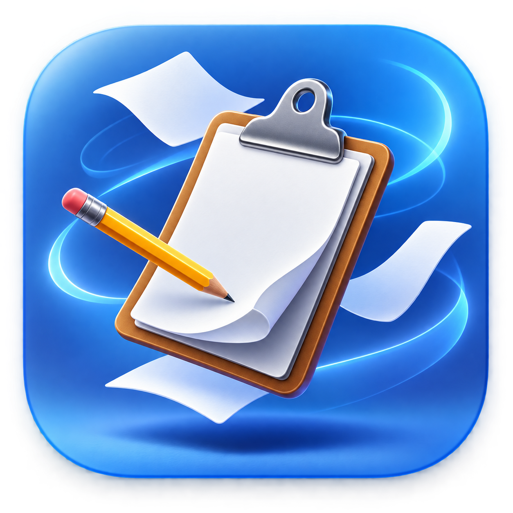
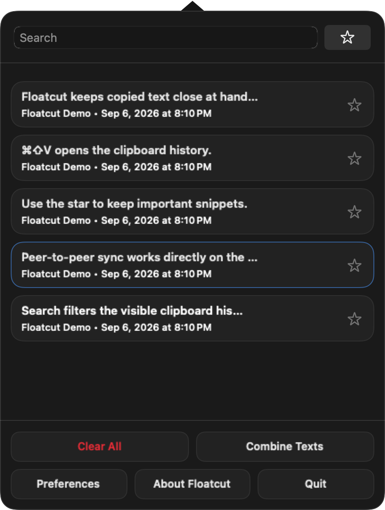

# Floatcut for macOS
English | [Deutsch](docs/readme.de.md)

<p align="center">
  
</p>

Floatcut is a lightweight clipboard manager for macOS. It keeps a searchable local history of copied text and images, provides a separate favorites store, and can exchange new clips directly with paired devices on the local network.

**Current version:** 4.5.0<br>
**User guide:** [English](docs/user-guide.md) · [Deutsch](docs/bedienung.md)

<p align="center">
  
</p>

## Features

- Fast clipboard history in the menu bar, search window, and keyboard-driven bezel
- Separate favorites store with per-item favorite and remove controls
- Configurable global shortcuts, history sizes, persistence, and appearance
- Local peer-to-peer synchronization with encrypted pairing and revocation
- Text synchronization plus optional per-peer transmission of PNG/JPEG images
- Visual marker for clips received from another device
- Manual migration from an existing Flycut installation
- English and German interface
- No iCloud dependency, cloud account, telemetry, or central clipboard server

## Requirements

- macOS 13.5 or later
- Accessibility permission for automatic pasting into the foreground application
- Local Network permission for peer discovery and synchronization

## Installation

1. Copy `Floatcut.app` to `/Applications`.
2. Start Floatcut. Official Developer ID-signed and notarized releases should open normally; local development builds may be blocked by macOS.
3. For a trusted local build only, use **System Settings → Privacy & Security → Open Anyway** if necessary.
4. Grant Accessibility permission when prompted if you want Floatcut to paste selected clips automatically.

For trusted local builds, Gatekeeper and Accessibility details are documented in [Release setup](docs/RELEASE_SETUP.md). Do not disable Gatekeeper globally.

## Basic usage

- Copy normally. Floatcut records supported clipboard content while capture is enabled.
- Click the menu bar icon to browse recent items.
- Press **Shift-Command-V** to open the bezel, then use the arrow keys and Return.
- Press **Shift-Command-B** to search the clipboard history.
- Click the star beside the search field to switch between history and favorites.
- Option-click the menu bar icon to temporarily disable or re-enable clipboard capture.

The shortcuts can be changed in **Settings → Hotkeys**. See the [full user guide](docs/user-guide.md) for favorites, synchronization, diagnostics, migration, and troubleshooting.

## Build

Install Xcode, then create a universal Release app bundle in `dist/`:

```bash
bash Scripts/package-app.sh
```

The results are `dist/Floatcut.app` and `dist/Floatcut_universal_<version>.dmg` (currently `Floatcut_universal_4.5.0.dmg`). This is a local, **non-notarized** build. Official releases use `Scripts/package-notarized-app.sh` with a Developer ID Application identity and Apple notary credentials; see [Release setup](docs/RELEASE_SETUP.md).

## Privacy and data storage

Clipboard history and favorites are stored locally for the current macOS user under Floatcut's application domain (`de.meierkarsten.floatcut`). They are not uploaded to iCloud. Peer-to-peer sync sends new clips only to explicitly paired, currently reachable devices; it does not provide cloud storage or an offline queue.

Clipboard managers can contain sensitive information. Floatcut can ignore password fields and password-like values, and capture can be paused with Option-click. Review the capture settings before using synchronization.

## Documentation

- [User guide (English)](docs/user-guide.md)
- [Bedienungsanleitung (Deutsch)](docs/bedienung.md)
- [Release, signing, and Gatekeeper setup](docs/RELEASE_SETUP.md)
- [Platform and migration notes](docs/PLATFORM_NOTES.md)
- [Synchronization protocol](docs/Protocol/)

## Origins and license

Floatcut continues the work of [Jumpcut](https://github.com/snark/jumpcut) and [Flycut](https://github.com/haad/Flycut/). See **Settings → Acknowledgements** for detailed credits.

Copyright © 2002 - 2019 by Steven Cook (Jumpcut)<br>
Copyright © 2011, General Arcade, Gennadiy Potapov, Adam Hamsik (Flycut)<br>
Copyright © 2026 by Karsten Meier (Floatcut)

Floatcut is released under the [MIT License](LICENSE).
